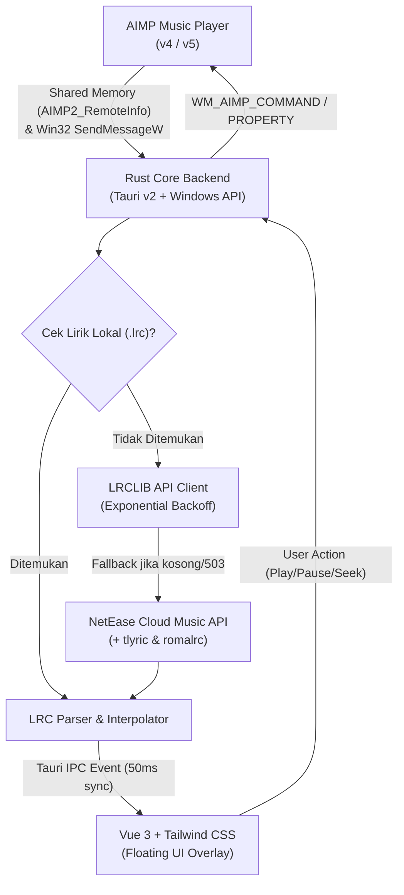

# 🎵 AIMP Floating Lyrics Online

<div align="center">


[](https://github.com/rifkinp/aimp-floating-lyrics-online/releases/latest)


**A modern, lightweight, transparent, always-on-top desktop lyrics overlay for AIMP Player with instant multi-provider fallback, bilingual translations, mini player controls, live seekbar, and in-app LRC editor.**

[⬇️ Download](#️-download) • [✨ Fitur Utama](#-fitur-utama) • [🚀 Cara Menjalankan](#-cara-menjalankan-portable--standalone) • [🛠 Cara Kerja & Arsitektur](#-cara-kerja--arsitektur) • [⌨ Kontrol & Shortcut](#-daftar-kontrol--shortcut) • [💻 Kompilasi Source](#-kompilasi-dari-source-code) • [❓ FAQ](#-faq--troubleshooting)

</div>

---

## ⬇️ Download

Versi rilis siap pakai (*portable*, tanpa perlu instalasi rumit) dapat langsung diunduh melalui tautan di bawah atau di halaman [**GitHub Releases**](https://github.com/rifkinp/aimp-floating-lyrics-online/releases):

| Versi | Tipe Berkas | Target Sistem | Tautan Unduhan Langsung | Ukuran |
| :--- | :--- | :--- | :--- | :--- |
| **v0.2.0 (Latest)** | Portable Archive (`.zip`) | Windows 10 & 11 (64-bit) | [📦 **AIMP-Floating-Lyrics-v0.2.0-windows-x64.zip**](https://github.com/rifkinp/aimp-floating-lyrics-online/releases/download/v0.2.0/AIMP-Floating-Lyrics-v0.2.0-windows-x64.zip) | ~8.3 MB |
| **v0.1.0** | Portable Archive (`.zip`) | Windows 10 & 11 (64-bit) | [📦 AIMP-Floating-Lyrics-v0.1.0-windows-x64.zip](https://github.com/rifkinp/aimp-floating-lyrics-online/releases/download/v0.1.0/AIMP-Floating-Lyrics-v0.1.0-windows-x64.zip) | ~8.3 MB |

> [!TIP]
> **Quick Start:** Cukup unduh paket zip di atas, ekstrak ke folder mana saja di komputer Anda, lalu jalankan `AIMP Floating Lyrics.exe`. Semua dependensi (termasuk WebView2Loader dan konfigurasi User-Agent) sudah siap digunakan!

---

## ✨ Fitur Utama

### 1. 🎤 Tampilan Lirik Fleksibel & Sinkronisasi Presisi
- **3 Mode Tampilan Lirik:**
  - **Two-Line Mode:** Baris aktif yang disorot + preview baris berikutnya.
  - **Single-Line Mode:** Tampilan lirik satu baris minimalis dengan transisi *smooth fade*.
  - **Karaoke Sweep Mode:** Efek sapuan warna lirik per suku kata (*syllable-level sweep*).
- **Smooth `requestAnimationFrame` Interpolation:** Teks bergulir sangat mulus tanpa lag di antara interval polling 50ms Win32 AIMP.
- **Dual Lyrics (Terjemahan Bilingual & Romaji):** Menampilkan terjemahan bahasa (*bilingual*) atau pelafalan Romaji/Pinyin di bawah lirik utama secara otomatis.
- **Hover Songbook / Full Lyric View:** Tinjau seluruh lirik lagu dengan fitur auto-scroll dan klik-untuk-lompat (*seek*). **Ketat terhadap sensor kursor:** jendela otomatis kembali ke lirik sinkron begitu mouse keluar dari area overlay.

### 2. 🌐 Multi-Provider Lyric Fallback Pipeline
Aplikasi mencari lirik dengan hierarki fallback otomatis tanpa jeda:
```
1. File Lokal (.lrc) di folder lagu yang sama
       ↓ (jika tidak ada)
2. LRCLIB Official API (Exact Match via Artist + Title + Duration)
       ↓ (jika tidak ada / server overload 503)
3. NetEase Cloud Music API (Mendukung lirik Mandarin, Jepang, Romaji & Terjemahan)
       ↓ (jika tidak ada)
4. LRCLIB Fuzzy Search Query
       ↓ (jika tidak ada)
5. Offline Cache Lokal (%APPDATA%/aimp-floating-lyrics/cache/)
```
- **Resilient & Anti-Spam:** Dilengkapi penanganan pintar terhadap *HTTP 503 (Server Overload)* dan *HTTP 429 (Rate Limit)* dengan *exponential backoff retry*.
- **Auto-Save ke Folder Lagu:** Lirik yang baru diunduh otomatis disimpan sebagai berkas `.lrc` di samping file audio agar instan saat diputar kembali offline.

### 3. 🎛 Mini Music Controller & Live Progress Bar
- **Kontrol Musik Terintegrasi:** Tombol *Previous*, *Play / Pause Toggle*, dan *Next* langsung di toolbar overlay via Win32 IPC messages (`WM_AIMP_COMMAND = 0x0475`).
- **Deteksi Album Art Otomatis:** Menampilkan thumbnail cover album lokal (`cover.jpg/png`, `folder.jpg/png`, `front.jpg/png`) langsung di sudut kiri toolbar.
- **Seekbar Progres Interaktif:** Progress bar mini dengan informasi `${pos} / ${dur}` yang dapat diklik langsung untuk melompat (*seek*) posisi lagu di AIMP.

### 4. ✏ In-App Quick LRC Editor
- **Modal Editor Visual Bawaan:** Edit teks atau perbaiki ketepatan timing lirik tanpa perlu software pihak ketiga.
- **Tombol "Insert Current Timestamp":** Sisipkan tag waktu `[mm:ss.xx]` secara instan mengikuti detik lagu yang sedang berjalan di AIMP dengan sekali klik.
- **Simpan Otomatis:** Perubahan langsung diperbarui di layar, di folder lagu, dan di database cache.

### 5. 🖥 Multi-Monitor & Smart Screen Docking
- **Dukungan Multi-Monitor:** Mendeteksi monitor primer maupun sekunder secara presisi dengan penyesuaian resolusi dan DPI scale factor.
- **Screen Docking:**
  - **Above Taskbar:** Menempel rapi tepat di atas taskbar Windows.
  - **Top Screen:** Menempel di tepi atas layar.
  - **Free Float:** Geser dan letakkan bebas di mana pun sesuai kenyamanan.
- **Glassmorphism & Opacity Slider:** Sesuaikan transparansi latar belakang (0% hingga 100%) dan efek blur akrilik modern.
- **Mode Tembus Pandang / Click-Through:** Mengunci jendela overlay agar klik mouse tembus ke aplikasi di belakangnya (misalnya saat bermain game atau bekerja).

---

## 🚀 Cara Menjalankan (Portable / Standalone)

Anda tidak perlu menginstal Node.js atau Rust untuk menjalankan aplikasi ini:

1. Unduh paket dari [**Bagian Download**](#️-download) atau gunakan folder `release/`.
2. Pastikan berkas-berkas berikut tetap berada dalam folder yang sama:
   - **`AIMP Floating Lyrics.exe`** *(Aplikasi utama)*
   - **`WebView2Loader.dll`** *(Pustaka runtime WebView2 untuk GUI Tauri)*
   - **`.env`** *(Konfigurasi identitas User-Agent LRCLIB)*
3. Jalankan **`AIMP Floating Lyrics.exe`**.
4. Putar lagu apa saja di **AIMP Player** — lirik akan langsung terdeteksi, diunduh, dan tersinkronisasi!

> [!TIP]
> **Kunci / Buka Kunci Cepat:** Tekan `Ctrl + Alt + L` kapan saja untuk mengunci jendela agar tembus pandang (*click-through*), atau buka kunci kembali dari menu System Tray.

---

## 🛠 Arsitektur & Cara Kerja



---

## ⌨ Daftar Kontrol & Shortcut

| Kontrol / Pintasan | Fungsi |
| :--- | :--- |
| **`Ctrl + Alt + L`** | **Global Hotkey:** Mengunci / Membuka mode Click-Through (tembus pandang mouse). |
| **Hover Kursor** | Memunculkan toolbar mini, kontrol musik, album art, dan seekbar. |
| **Tombol `Full` / `Synced`** | Beralih antara tampilan lirik baris sinkron dan tampilan buku lagu (*Songbook*). |
| **Tombol Pensil (`Edit3`)** | Membuka in-app Quick LRC Editor untuk memperbaiki lirik & timestamp. |
| **Tombol `+0.5s` / `-0.5s`** | Menggeser sync offset bila ada selisih detik antara audio dan lirik. |
| **Klik Seekbar** | Melompat (*seek*) posisi putar lagu langsung di AIMP Player. |
| **Klik Kiri Tray Icon** | Menampilkan atau memfokuskan jendela overlay. |
| **Klik Kanan Tray Icon** | Membuka menu context: Lock/Unlock, Search Manual, Settings, Quit. |

---

## 📂 Struktur Konfigurasi & Cache

Semua pengaturan dan cache disimpan rapi di direktori standar Windows pengguna:

- **Pengaturan Aplikasi:**
  `%APPDATA%\aimp-floating-lyrics\config.json`
- **Cache Lirik Offline:**
  `%APPDATA%\aimp-floating-lyrics\cache\*.lrc`
- **Data Webview Browser:**
  `%LOCALAPPDATA%\com.aimp.floatinglyrics\`

### Contoh Isi `config.json`:
```json
{
  "clickThrough": false,
  "displayMode": "two-line",
  "fontSize": 46,
  "fontFamily": "Inter, system-ui, sans-serif",
  "activeColor": "#38BDF8",
  "secondaryColor": "rgba(255, 255, 255, 0.65)",
  "strokeColor": "#000000",
  "strokeWidth": 2.0,
  "textAlign": "center",
  "saveToAudioFolder": true,
  "closeWithAimp": false,
  "showDualLyrics": true,
  "dualLyricsType": "translation",
  "backgroundOpacity": 0.15,
  "enableGlassmorphism": true,
  "dockPosition": "bottom-taskbar",
  "targetMonitor": null
}
```

---

## 💻 Kompilasi dari Source Code

### Kebutuhan Sistem:
- **Node.js** v18+ dan `npm`
- **Rust Toolchain** v1.81+ target `x86_64-pc-windows-gnu`
- **MinGW-w64 UCRT** (tersedia melalui WinGet: `BrechtSanders.WinLibs.POSIX.UCRT`)

### Langkah-langkah:

1. **Clone repository:**
   ```bash
   git clone https://github.com/rifkinp/aimp-floating-lyrics-online.git
   cd aimp-floating-lyrics-online
   ```

2. **Instal dependensi frontend:**
   ```bash
   npm install
   ```

3. **Build Frontend:**
   ```bash
   npm run build
   ```

4. **Kompilasi Binary Release Rust (Tauri):**
   ```bash
   cd src-tauri
   cargo build --release
   ```

File binary yang sudah siap pakai akan berada di `src-tauri/target/release/aimp-floating-lyrics.exe`.

---

## ❓ FAQ & Troubleshooting

<details>
<summary><b>1. Kenapa ada file <code>WebView2Loader.dll</code> dan <code>.env</code> di samping file .exe?</b></summary>

- **`WebView2Loader.dll`**: Pustaka resmi Microsoft untuk menghubungkan Tauri dengan engine Chromium bawaan Windows 10/11. File ini dibutuhkan saat menggunakan target kompilasi GNU/MinGW agar aplikasi dapat langsung berjalan tanpa instalasi kompleks.
- **`.env`**: Menyimpan konfigurasi `LRCLIB_APP_ID` (identitas User-Agent aplikasi ke server API LRCLIB). Hal ini memastikan kuota permintaan lirik tidak terkena blokir rate-limit.
</details>

<details>
<summary><b>2. Mengapa lirik lagu tertentu tidak muncul secara otomatis?</b></summary>

- Pastikan metadata ID3 tag lagu (Judul & Nama Artis) di AIMP terisi dengan benar (tidak kosong atau hanya berupa nama file acak).
- Gunakan tombol **Pencarian Manual (Search)** di toolbar atau System Tray untuk mencari lirik berdasarkan kata kunci judul/artis secara spesifik.
- Anda juga dapat menggunakan tombol **LRC Editor** untuk menempelkan teks lirik secara manual dan menyimpan ke file `.lrc`.
</details>

<details>
<summary><b>3. Bagaimana cara membuka jendela yang terkunci (Click-Through)?</b></summary>

Saat jendela terkunci, klik mouse akan tembus pandang ke desktop/aplikasi lain. Untuk membuka kuncinya:
1. Tekan kombinasi tombol **`Ctrl + Alt + L`** di keyboard, atau
2. Klik kanan ikon aplikasi di **System Tray** (dekat jam Windows) lalu pilih **"Lock / Click-Through (Toggle)"**.
</details>

<details>
<summary><b>4. Apakah AIMP perlu diatur secara khusus?</b></summary>

Tidak perlu. AIMP Player secara bawaan (default) telah mengaktifkan antarmuka Win32 Remote Access (`AIMPRemoteAccessClass` & `AIMP2_RemoteInfo`). Cukup pastikan AIMP sedang berjalan saat Anda menggunakan Floating Lyrics.
</details>

---

## 📄 Lisensi & Kredit

- Dibangun dengan ❤️ untuk komunitas pengguna setia **AIMP Player**.
- Didukung oleh penyedia database lirik terbuka: [LRCLIB](https://lrclib.net) & NetEase Cloud Music.
- Proyek ini dirilis di bawah lisensi [MIT License](LICENSE).
